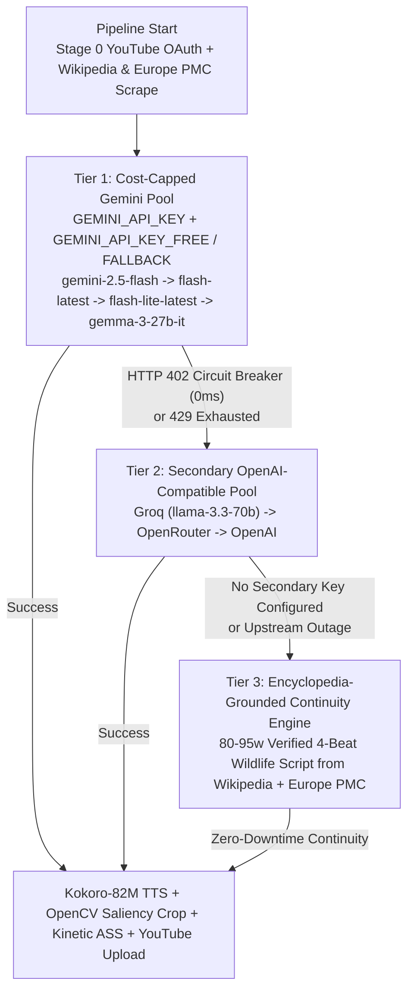

# Full Forensic Audit & Permanent Architecture: GitHub Actions Pipeline Failures

**Date:** November 26, 2026  
**Target Repository:** `thienphucnt/MPVSAP`

---

## 1. Failure Timeline & Scope

| Workflow | Last Successful Run | Failing Since | Consecutive Failures |
| :--- | :--- | :--- | :--- |
| **Daily Shorts Generator & Uploader** (`.github/workflows/main.yml`) | `43793407249` (`2026-11-16T02:38Z`, `4m48s`) | `43984930639` (`2026-11-17T00:06Z`) | **19 runs** (through `45726321402` on `2026-11-26T00:06Z`) |
| **Weekly Widescreen Long-Form Generator & Uploader** (`.github/workflows/long_form.yml`) | `43682213102` (`2026-11-15T05:42Z`, `12m8s`) | `44991471559` (`2026-11-22T05:55Z`) | **1 run** (most recent weekly schedule) |
| **AI Self-Healing & Diagnostics** (`.github/workflows/self_healing.yml`) | — | `2026-11-17` | **18+ runs** (through `45726798236` on `2026-11-26T00:10Z`) |

All pre-LLM stages (**Stage 0 YouTube OAuth Pre-Flight Check**, **Kokoro ONNX TTS validation**, and **Playwright Wikipedia species scraping**) were **passing**.

---

## 2. Full Root-Cause Analysis (7 Systemic Flaws Identified)

### Flaw 1 — Google AI Studio Prepay Credit Depletion (`HTTP 402`) & Why Credits Burned Fast
Every failing run crashed inside `generate_content()` -> `gemini_generate_with_retry()` with:

```text
402 RESOURCE_EXHAUSTED. {'error': {'code': 402, 'message': 'Your prepayment credits are depleted. Please go to AI Studio at https://ai.studio/projects to manage your project and billing. Learn more at https://ai.google.dev/gemini-api/docs/billing#prepay. ', 'status': 'RESOURCE_EXHAUSTED'}}
```

- **Why Google AI Studio locked the key:** Once a Google Cloud project is upgraded from Free Tier to **Paid Prepay**, exhausting the prepaid balance to `$0.00` **does not revert the project to Free Tier**—instead, Google permanently returns `HTTP 402` across **all** models on that project until credits are added, whereas an **unbilled AI Studio project** remains on the perpetual `$0` Free Tier (`gemini-2.5-flash`, `gemini-flash-latest`, `gemini-flash-lite-latest`, `gemma-3-27b-it`).
- **Why credits drained rapidly in `main.py`:**
  1. `gemini_generate_with_retry()` placed `gemini-2.0-flash` at index 0 and `gemini-2.5-flash` at index 1, so calling `model="gemini-2.5-flash"` sliced off index 0 and immediately escalated on any hiccup to **expensive `gemini-2.5-pro` and `gemini-pro-latest`**.
  2. `generate_content()` injected **all 248+ past titles + 248+ past topics (~500 lines / ~4,500 tokens)** into every prompt, growing linearly without bound on every uploaded video.

### Flaw 2 — `402` Billing Depletion Misclassified as a `429` 1-Minute Rate Limit
- **Location:** [`main.py`](file:///C:/Users/Admin/Documents/antigravity/vibrant-hawking/main.py), [`bot_agent.py`](file:///C:/Users/Admin/Documents/antigravity/vibrant-hawking/bot_agent.py)
- **Issue:** `is_quota_or_rate_limit` matched `"RESOURCE_EXHAUSTED"` without checking for HTTP `402` / `"PREPAYMENT CREDITS ARE DEPLETED"`. Every failed run retried 4 models across 3 passes and slept `62.0s` twice (~2.5 minutes wasted) with no circuit breaker, no secondary key/provider failover, and no encyclopedia continuity fallback.

### Flaw 3 — `self_heal.py` Crashed Deterministically on `402` (Doubling Failure Alerts)
- **Location:** [`self_heal.py`](file:///C:/Users/Admin/Documents/antigravity/vibrant-hawking/self_heal.py)
- **Issue:** `ENVIRONMENT_ERRORS` matched `r"429 RESOURCE_EXHAUSTED"` instead of `402 RESOURCE_EXHAUSTED` / `prepayment credits are depleted`. `classify_log_deterministically()` returned `None`, causing `self_heal.py` to call Gemini (including retired `gemini-1.5-pro-002` / `gemini-1.5-flash-002`) using the **same depleted `GEMINI_API_KEY`** and crash with exit code `1`.

### Flaw 4 — `heal_attempts.txt` Reset on Failed Runs & Never Persisted by `self_healing.yml`
- **Location:** [`.github/workflows/main.yml`](file:///C:/Users/Admin/Documents/antigravity/vibrant-hawking/.github/workflows/main.yml), [`.github/workflows/long_form.yml`](file:///C:/Users/Admin/Documents/antigravity/vibrant-hawking/.github/workflows/long_form.yml), [`.github/workflows/self_healing.yml`](file:///C:/Users/Admin/Documents/antigravity/vibrant-hawking/.github/workflows/self_healing.yml)
- **Issue:** `main.yml` and `long_form.yml` reset `heal_attempts.txt` to `"0"` inside `if: always()` (even on failed runs), while `self_healing.yml` never persisted its incremented counter back to git.

### Flaw 5 — `run_history.json` 6,700-Line Ping-Pong Thrashing Between `logger.py` and `maintenance_sync.py`
- **Location:** [`maintenance_sync.py`](file:///C:/Users/Admin/Documents/antigravity/vibrant-hawking/maintenance_sync.py) vs. [`logger.py`](file:///C:/Users/Admin/Documents/antigravity/vibrant-hawking/logger.py)
- **Issue:** `logger.py` caps `dashboard/app/data/run_history.json` at the newest 100 runs (`history[-100:]`), whereas `maintenance_sync.py` paginated 10 pages (all 315 historical GitHub runs back to Run #1) and re-appended all 215 truncated ancient runs on every run—causing `run_history.json` to oscillate between 100 and 315 entries (`+5,880 / -2,838` line git commits twice daily).

### Flaw 6 — Stale Playwright Chromium Cache Re-Downloading 327 MB on Every Run
- **Location:** [`.github/workflows/main.yml`](file:///C:/Users/Admin/Documents/antigravity/vibrant-hawking/.github/workflows/main.yml), [`.github/workflows/long_form.yml`](file:///C:/Users/Admin/Documents/antigravity/vibrant-hawking/.github/workflows/long_form.yml)
- **Issue:** `pip install --upgrade -r requirements.txt` upgraded unpinned `playwright` (expecting `chromium-1255`), while `actions/cache` keyed on `hashFiles('requirements.txt')` (which never changed and restored stale `chromium-1234`), forcing `main.py` to delete `chromium-1234` and download 327 MB at runtime on every run.

### Flaw 7 — GitHub Actions Node 20 Deprecation & Legacy Error Telemetry
- **Locations:** All 4 `.github/workflows/*.yml` files (`actions/checkout@v4`, `actions/setup-python@v5`, `actions/cache@v4` emitting Node 20 deprecation warnings on Ubuntu 26.04) and `main.py` logging `category="space"` on unhandled exceptions.

---

## 3. Permanent Multi-Layer Architecture Implemented



1. **Cost-Capped Multi-Key & Multi-Provider LLM Router (`main.py`):**
   - Removed accidental escalation to paid `Pro` models; defaults to `["gemini-2.5-flash", "gemini-flash-latest", "gemini-flash-lite-latest", "gemma-3-27b-it"]`.
   - Compacted `prohibited_list` prompt context to the 80 most relevant/recent items (~65% token reduction) while keeping 100% full-history deduplication in Python (`is_duplicate_topic`).
   - Added a process-wide `HTTP 402` / invalid-key circuit breaker (`_DEPLETED_GEMINI_CLIENT_IDS`) that fails over in `0ms` with zero `62s` sleeps across secondary Gemini keys (`GEMINI_API_KEY_FREE`, `GEMINI_API_KEY_FALLBACK`, comma-separated `GEMINI_API_KEY`) and OpenAI-compatible providers (`GROQ_API_KEY`, `OPENROUTER_API_KEY`, `OPENAI_API_KEY`).
2. **Encyclopedia-Grounded Continuity Engine (`synthesize_extractive_wildlife_content` in `main.py`):**
   - Guarantees zero pipeline downtime even if all external LLM keys are simultaneously depleted or unreachable, synthesizing phonetic-expanded 80–95 word 4-beat zoological scripts directly from verified Wikipedia + Europe PMC extracts (for both Shorts and 10-segment Long-Form compilations).
3. **Self-Healing & Counter Fixes (`self_heal.py`, `self_healing.yml`, `main.yml`, `long_form.yml`):**
   - Added `BILLING_ERRORS` (`402 RESOURCE_EXHAUSTED`, `prepayment credits are depleted`) to `classify_log_deterministically()` so billing/auth issues log actionable guidance and exit `0` without calling LLMs.
   - Only reset `heal_attempts.txt` on `if: success()`, and persist incremented counter in `self_healing.yml`.
4. **Aligned 100-Entry Rolling Telemetry (`maintenance_sync.py`):**
   - Restricted run backfill to `per_page=100` within `min_tracked_ts` and enforced `history[-100:]`, permanently eliminating the 6,700-line git diff thrashing.
5. **Dynamic Playwright Version Cache & Node 24 Actions (`main.yml`, `long_form.yml`, `self_healing.yml`, `antigravity_bot.yml`):**
   - Upgraded all workflows to Node 24 native actions (`actions/checkout@v7`, `actions/setup-python@v7`, `actions/cache@v6`) and keyed `~/.cache/ms-playwright` on the exact installed `playwright` package version.
