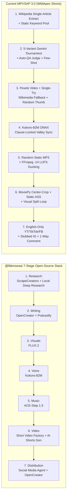

# Audit & Architecture Plan: `@libknowsai` AI Content Factory vs. MPVSAP 3.0

## 1. Executive Summary of the Threads Post

The Threads post by **Lib (`@libknowsai`)** ([`Dfeyez9jQOc`](https://www.threads.com/@libknowsai/post/Dfeyez9jQOc)) maps out a 7-stage open-source "AI Content Factory" for solo creators:

$$\text{Research} \longrightarrow \text{Writing} \longrightarrow \text{Visuals} \longrightarrow \text{Voice} \longrightarrow \text{Music} \longrightarrow \text{Video} \longrightarrow \text{Distribution}$$

### The 10 Open-Source Repositories Featured in the Post

| # | Repository | Stage | Stars / License | Core Capability |
| :--- | :--- | :--- | :--- | :--- |
| **1** | [`krillinai/OpenCreator`](https://github.com/krillinai/OpenCreator) | Workspace & Localization | 14.2k ⭐ (`Apache-2.0`) | All-in-one creator workspace; automated video translation, dubbing, and subtitle localization into 120+ languages. |
| **2** | [`ScrapeCreators/social-media-research-skills`](https://github.com/ScrapeCreators/social-media-research-skills) | Research & Hooks | 6.0k ⭐ (`MIT`) | Agent skills (`outlier-post-finder`, `comment-mining`, `trend-discovery`, `transcript-intelligence`) to mine audience questions and viral hooks. |
| **3** | [`LearningCircuit/local-deep-research`](https://github.com/LearningCircuit/local-deep-research) | Deep Research | 9.5k ⭐ (`MIT`) | Multi-source deep synthesis across web, PubMed, arXiv, and Wikipedia (~95% SimpleQA accuracy) with cross-checked facts. |
| **4** | [`black-forest-labs/flux2`](https://github.com/black-forest-labs/flux2) | Visuals & Thumbnails | 2.8k ⭐ (`Apache-2.0` Klein 4B) | High-resolution image synthesis & editing for thumbnails, visual hooks, and B-roll gaps. |
| **5** | [`hexgrad/kokoro`](https://github.com/hexgrad/kokoro) | Voice (TTS) | 10.0k ⭐ (`Apache-2.0`) | Lightweight 82M-parameter open-weight neural TTS (`Kokoro-82M`). |
| **6** | [`ace-step/ACE-Step-1.5`](https://github.com/ace-step/ACE-Step-1.5) | Music Generation | 14.5k ⭐ (`MIT`) | Local AI music & instrumental generation and audio section editing. |
| **7** | [`YILS-LIN/short-video-factory`](https://github.com/YILS-LIN/short-video-factory) | Video Assembly | 6.1k ⭐ (`AGPL-3.0`) | Batch short-video assembly with kinetic subtitle animations and transitions. |
| **8** | [`Anil-matcha/AI-Youtube-Shorts-Generator`](https://github.com/Anil-matcha/AI-Youtube-Shorts-Generator) | Clipping & Smart Crop | 5.8k ⭐ (`MIT`) | Open-source Opus Clip alternative: LLM virality highlight ranking + OpenCV saliency/face-tracked 16:9 $\rightarrow$ 9:16 vertical cropping. |
| **9** | [`souzatharsis/podcastfy`](https://github.com/souzatharsis/podcastfy) | Conversational Audio | 6.8k ⭐ (`Apache-2.0`) | Open-source NotebookLM podcast alternative: transforms source text into dynamic multi-voice conversational banter. |
| **10** | [`langchain-ai/social-media-agent`](https://github.com/langchain-ai/social-media-agent) | Distribution | 3.0k ⭐ (`MIT`) | Turns published URLs/scripts into platform-native social posts (X, Threads, LinkedIn) with scheduling. |

---

## 2. Head-to-Head Comparison: Existing MPVSAP 3.0 vs. Threads Stack

### Where MPVSAP 3.0 Already Excels (No Replacement Needed)
1. **Voice (`Kokoro-82M`):** We already run `Kokoro-82M` locally on CPU via `kokoro-onnx==0.5.0` in [`synthesize_kokoro_audio_and_timestamps()`](file:///C:/Users/Admin/Documents/antigravity/vibrant-hawking/main.py#L1940-L2008), and our custom **Clause-Locked Sample Anchoring + Acoustic Valley Word-Boundary Aligner** (`0.000s` drift) plus Studio Mastering (`80Hz` highpass, `2.5kHz` EQ, compand) is significantly more accurate than standard TTS wrappers.
2. **Script QA (`5-Variant Tournament`) & Seamless Looping:** Our 2-pass head-to-head tournament evaluator in [`evaluate_tournament_variants()`](file:///C:/Users/Admin/Documents/antigravity/vibrant-hawking/main.py#L1030-L1130) and seamless visual loop split in [`assemble_video()`](file:///C:/Users/Admin/Documents/antigravity/vibrant-hawking/main.py#L2769-L2880) are purpose-built for autonomous CI execution, whereas `OpenCreator` and `Short Video Factory` are interactive desktop GUI tools that cannot run unattended in GitHub Actions.
3. **CI Runtime Constraints vs. Heavy GPU Models (`FLUX.2` & `ACE-Step 1.5`):** Running 4B+ parameter diffusion models (`FLUX.2`) or diffusion music generators (`ACE-Step 1.5`) directly inside a free CPU-only GitHub Actions runner (`ubuntu-latest`) would exceed the 30-minute job timeout. Instead, we should adopt **lightweight/API-backed equivalents in CI** and keep heavy model generation optional or offline.

---

## 3. High-Impact Improvements Identified for MPVSAP

By auditing [`main.py`](file:///C:/Users/Admin/Documents/antigravity/vibrant-hawking/main.py), [`maintenance_sync.py`](file:///C:/Users/Admin/Documents/antigravity/vibrant-hawking/maintenance_sync.py), and [`.github/workflows/long_form.yml`](file:///C:/Users/Admin/Documents/antigravity/vibrant-hawking/.github/workflows/long_form.yml) against the 10 repos, we identified **6 concrete architectural gaps & bugs** we can implement cleanly within our zero-cost GitHub Actions environment:

> [!IMPORTANT]
> **Critical Bug Uncovered During Audit in [`search_wikimedia_image()`](file:///C:/Users/Admin/Documents/antigravity/vibrant-hawking/main.py#L2152-L2176):**
> Even though `search_wikimedia_image()` requests `srlimit: 5` results from Wikimedia Commons, it **only inspects `results[0]`**! If `results[0]` is an `.svg`, `.tif`, `.pdf`, or `.ogg`/`.webm` file, line 2176 immediately executes `return None` without checking `results[1..4]`, and never checks Wikipedia's native `pageimages` API (`prop=pageimages&piprop=original`) for the species' verified lead photograph. This causes niche species to fall back to unrelated generic clips (`"sea turtle"`, `"tropical fish"`).

### Improvement 1: Multi-Source Deep Fact Ingestion & Viewer Comment Mining (Inspired by `local-deep-research` & `social-media-research-skills`)
* **Current Gap:**
  1. [`fetch_wikipedia_source_text()`](file:///C:/Users/Admin/Documents/antigravity/vibrant-hawking/main.py#L836-L975) truncates after the first 1,200 words (often taxonomic classification lists) and relies on a single source.
  2. [`maintenance_sync.py`](file:///C:/Users/Admin/Documents/antigravity/vibrant-hawking/maintenance_sync.py#L59-L129) syncs `commentCount`, and [`post_top_level_engagement_comment()`](file:///C:/Users/Admin/Documents/antigravity/vibrant-hawking/main.py#L3461-L3499) posts questions, but we **never mine viewer comments** or track **outlier velocity** (views vs. channel median).
* **Planned Upgrade:**
  1. **Multi-Source Fact Enrichment (`main.py`):** Ingest the Wikipedia species extract alongside targeted anatomical/behavioral sections (`Behavior`, `Venom`, `Anatomy`, `Diet`, `Predation`) **plus** parallel scientific abstract snippets from **Europe PMC REST API** (0 API keys required, `<0.4s` response) so Gemini has verified quantitative metrics (bite force in Newtons, strike velocity, toxin $LD_{50}$, depth in meters).
  2. **Comment Mining & Outlier Tagging (`maintenance_sync.py` & `main.py`):** Query `youtube.commentThreads().list(videoId=...)` on recent videos during maintenance sync to harvest viewer species requests/questions into `dashboard/app/data/viewer_signals.json`, and compute each video's **Outlier Multiplier** (`views / channel_median_views`) so `get_run_score()` prioritizes true viral outliers for few-shot prompt injection.

### Improvement 2: Wikipedia Lead-Photo Priority, Multi-Result Wikimedia Loop & Species-Specific Thumbnails (Inspired by `FLUX.2`)
* **Current Gap:**
  1. [`search_wikimedia_image()`](file:///C:/Users/Admin/Documents/antigravity/vibrant-hawking/main.py#L2124-L2180) aborts if `results[0]` is non-raster and ignores Wikipedia's curated `pageimages` lead species photo.
  2. [`generate_thumbnail()`](file:///C:/Users/Admin/Documents/antigravity/vibrant-hawking/main.py#L3206) picks `bg_query = random.choice(cat_info["kw_defaults"])` instead of the actual topic/species, and leaves a stale `temp_thumb_bg_4810.jpg` in the repo if interrupted.
* **Planned Upgrade:**
  1. **Wikipedia `pageimages` + Full 5-Result Wikimedia Loop (`main.py`):** First query Wikipedia's `prop=pageimages&piprop=original` for the exact species/query, then iterate through **all** `results[0..4]` in `search_wikimedia_image()` until a valid high-resolution raster image (`.jpg`, `.png`, `.webp`) is found.
  2. **Optional AI Image Synthesis Fallback & Species-Locked Thumbnail (`main.py`):** Update `generate_thumbnail()` to use the winning segment's actual species/visual keyword (with optional Gemini Imagen 3 / Pollinations FLUX.2 fallback if Pexels/Wikimedia have no photo).

### Improvement 3: OpenCV Saliency-Tracked Vertical Cropping & Kinetic Pop-In Subtitles (Inspired by `AI-Youtube-Shorts-Generator` & `short-video-factory`)
* **Current Gap:**
  1. In [`assemble_video()`](file:///C:/Users/Admin/Documents/antigravity/vibrant-hawking/main.py#L2841-L2843), video clips are cropped strictly at the geometric center (`left = (new_w - target_w) // 2`), cutting off animals positioned off-center, and line 2884 (`VideoFileClip(v_path).resize(newsize=config.resolution)`) stretches non-matching aspect ratios!
  2. In [`generate_ass_file()`](file:///C:/Users/Admin/Documents/antigravity/vibrant-hawking/main.py#L2684), 2–3 word subtitle chunks appear statically without pop-in animation.
* **Planned Upgrade:**
  1. **Aspect-Preserving OpenCV Saliency Crop (`main.py`):** Compute the high-contrast/motion focal center `(cx, cy)` per video clip using `cv2` (already installed via `opencv-python-headless`) and perform aspect-ratio-preserving crop-and-zoom centered on the animal subject rather than stretching `.resize(newsize=config.resolution)`.
  2. **Kinetic Pop-In ASS Tag (`main.py`):** Prepend `{\fscx114\fscy114\t(0,75,\fscx100\fscy100)}` to each Short phrase dialogue line in `generate_ass_file()` for crisp, zero-overhead kinetic pop-in captions.

### Improvement 4: Acoustic Mood-Matched BGM Selection (Inspired by `ACE-Step 1.5`)
* **Current Gap:** [`assemble_video()`](file:///C:/Users/Admin/Documents/antigravity/vibrant-hawking/main.py#L2944) selects `music_path = random.choice(music_files)`, sometimes pairing a slow ambient drone with a high-speed predator ambush script.
* **Planned Upgrade:**
  1. **Mood-Tagged Track Matcher (`main.py`):** Map our 17 existing `.mp3` tracks across `music/{space,history,tech}/` by mood/energy profile (`high_tension`, `abyssal_dread`, `clinical_thriller`, `bioluminescent_wonder`) and select the track that matches the winning variant's `angle` and script intensity.

### Improvement 5: Optional Dual-Voice Contrast Hook & Long-Form `kokoro-cache` Fix (Inspired by `Podcastfy` & `Kokoro`)
* **Current Gap:**
  1. [`.github/workflows/long_form.yml#L52-L57`](file:///C:/Users/Admin/Documents/antigravity/vibrant-hawking/.github/workflows/long_form.yml#L52-L57) uses stale cache key `kokoro-onnx-v1.0` and lacks the pre-download `curl` step present in `main.yml`.
  2. All videos are 100% single-voice, even when a 2-voice documentary contrast (e.g., `af_heart` or `bf_emma` delivering the 3-second shock hook / myth, followed by `am_fenrir` delivering the scientific breakdown) or multi-host Long-Form narration could boost retention.
* **Planned Upgrade:**
  1. **Fix `long_form.yml` Kokoro Cache Step:** Sync the Kokoro cache & pre-download step in `.github/workflows/long_form.yml` with `main.yml`.
  2. **Dual-Voice Hook / Banter Support (`main.py`):** Add an optional `--voice-mode` (`solo` default vs. `duo` contrast hook where Beat 1 / Hook is synthesized with `af_heart` or `bf_emma` and Beats 2–4 with `am_fenrir`, seamlessly concatenated with clause-locked sample accuracy).

### Improvement 6: Multi-Language YouTube Metadata/CC Localization & Long-to-Short Clipper (Inspired by `OpenCreator`, `AI-Youtube-Shorts-Generator` & `social-media-agent`)
* **Current Gap:**
  1. Every Short is uploaded with English-only title, description, and captions, missing out on YouTube's automatic international Shorts shelf (Spanish, Portuguese, Hindi, etc.).
  2. Weekly Long-Form compilations (`--format long`) and Daily Shorts are completely separate; we cannot automatically slice a Long-Form segment into a 9:16 vertical Short.
* **Planned Upgrade:**
  1. **Zero-Render Multi-Language YouTube Localization (`main.py`):** In `upload_to_youtube()`, add an automatic localization pass using Gemini to translate `title` and `description` into top global languages (`es`, `pt`, `hi`, `de`, `fr`, `ja`, `ko`, `vi`) and push them via `youtube.videos().update(part="snippet,localizations")` so international viewers see native titles/descriptions immediately.
  2. **Social Distribution Bundle Logging (`main.py`):** Generate ready-to-post X/Threads/Community teaser copy alongside each run in `run_history.json`.

---

## 4. Proposed Implementation Roadmap (For Your Review)

| Phase | Target Files | Scope & Deliverable | Risk / CI Impact |
| :--- | :--- | :--- | :--- |
| **Phase 1: Research & Visuals Hardening** | `main.py`, `maintenance_sync.py` | • Multi-section Wikipedia + Europe PMC scientific metric ingestion • Fix `search_wikimedia_image()` 5-result loop + Wikipedia `pageimages` lead photo • Species-specific thumbnail query in `generate_thumbnail()` • Viewer comment mining & outlier score multiplier in `maintenance_sync.py` | **Zero extra CI time** (`+0.5s` API calls), eliminates generic fallback B-roll on niche species. |
| **Phase 2: Video, Audio & Subtitle Polish** | `main.py`, `.github/workflows/long_form.yml` | • Aspect-preserving OpenCV saliency crop (fixes stretched `.resize(newsize=...)` & center-only crops) • Kinetic pop-in ASS subtitle tag (`\fscx114\fscy114\t(0,75,...)`) • Mood-matched BGM track selector • Optional `--voice-mode duo` (`Podcastfy`-style contrast hook) • Sync `long_form.yml` Kokoro cache | **Zero extra CI time**, cleaner framing, higher retention captions. |
| **Phase 3: Global Localization & Distribution** | `main.py`, `test_pipeline.py` | • Multi-language YouTube `localizations` (`es`, `pt`, `hi`, `ja`, `ko`, `de`, `fr`) on upload • Unit tests in `test_pipeline.py` covering all new functions | **+1.2s** Gemini translation call during upload; expands reach to global non-English Shorts feeds. |
